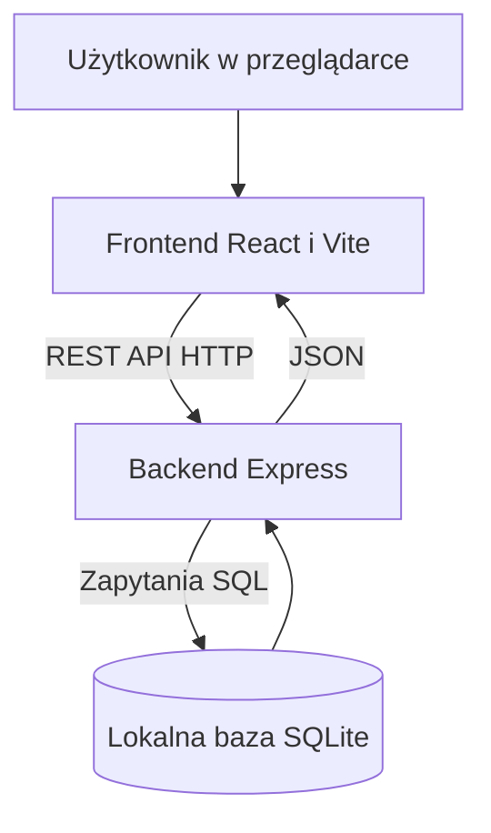

# SalaGo

SalaGo to aplikacja edukacyjna do przeglądania i zarządzania salami uczelnianymi. W aktualnej wersji użytkownik może wyświetlać listę sal, filtrować ją według dostępności i minimalnej pojemności oraz dodawać, edytować i usuwać sale. Aplikacja nie obsługuje jeszcze rezerwacji terminów, logowania ani powiadomień.

## Aktualny stan projektu

- Frontend: React i Vite.
- Backend: Node.js i Express, REST API.
- Baza danych: lokalna SQLite (`backend/salago.db`).
- Integracja: HTTP JSON pomiędzy frontendem a backendem, zapytania SQL do SQLite.
- Środowisko: lokalne. Integracja z Azure SQL Database i automatyczne wdrożenie nie zostały jeszcze wykonane.

## Architektura



## Struktura repozytorium

| Ścieżka | Znaczenie |
|---|---|
| `frontend/` | Interfejs React, formularz i lista sal |
| `frontend/src/services/api.js` | Wywołania REST API |
| `backend/server.js` | Endpointy CRUD i walidacja po stronie serwera |
| `backend/database.js` | Utworzenie bazy i tabeli SQLite, dane początkowe |
| `backend/salago.db` | Lokalny plik danych, ignorowany przez Git |
| `config/`, `docs/` | Katalogi pomocnicze projektu |

## Uruchomienie lokalne

Wymagane są Node.js 22, npm i dwa terminale. Polecenia `npm.cmd` są przeznaczone dla PowerShell w Windows; w innych powłokach można użyć `npm`.

### Backend

Otwórz terminal w folderze `backend` i uruchom:

```powershell
npm.cmd install
node server.js
```

API działa domyślnie na `http://localhost:3000`. Przy pierwszym uruchomieniu `backend/database.js` tworzy `salago.db`, tabelę `sale` i osiem przykładowych rekordów. Kolejne uruchomienia zachowują zapisane dane.

### Frontend

Otwórz drugi terminal w folderze `frontend` i uruchom:

```powershell
npm.cmd install
```

Utwórz lokalny plik `frontend/.env.local`:

```env
VITE_API_BASE_URL=http://localhost:3000/api
VITE_USE_MOCK=false
```

Następnie uruchom:

```powershell
npm.cmd run dev
```

Otwórz adres podany przez Vite, zwykle `http://localhost:5173`. Backend musi być uruchomiony równolegle. Zmienne `VITE_*` są widoczne po stronie przeglądarki, więc nie należy w nich umieszczać haseł.

### Budowanie frontendu

```powershell
cd frontend
npm.cmd run build
```

Wynikiem jest folder `frontend/dist/`.

## REST API

Adres bazowy: `http://localhost:3000/api`.

| Metoda | Endpoint | Opis | Sukces | Typowe błędy |
|---|---|---|---|---|
| GET | `/sale` | Pobranie listy sal | 200 | — |
| GET | `/sale/:id` | Pobranie wskazanej sali | 200 | 404 |
| POST | `/sale` | Utworzenie sali | 201 | 400 |
| PUT | `/sale/:id` | Pełna aktualizacja sali | 200 | 400, 404 |
| DELETE | `/sale/:id` | Usunięcie sali | 204 (bez treści) | 404 |

Przykładowe żądanie `POST /api/sale`:

```json
{
  "nazwa": "D101",
  "budynek": "D",
  "pietro": 1,
  "pojemnosc": 35,
  "wyposazenie": ["rzutnik", "tablica"],
  "dostepna": true
}
```

Przykładowa odpowiedź `201 Created` (identyfikator zależy od stanu bazy):

```json
{
  "id": 9,
  "nazwa": "D101",
  "budynek": "D",
  "pietro": 1,
  "pojemnosc": 35,
  "wyposazenie": ["rzutnik", "tablica"],
  "dostepna": true
}
```

Przykładowa odpowiedź błędu walidacji `400 Bad Request`:

```json
{ "error": "Niepoprawna pojemność" }
```

## Baza danych i walidacja

Tabela `sale` ma kolumny: `id` (klucz główny), `nazwa`, `budynek`, `pietro`, `pojemnosc`, `wyposazenie` i `dostepna`. Lista wyposażenia jest zapisywana jako JSON w kolumnie tekstowej, a dostępność jako wartość 0 lub 1. Backend konwertuje te dane do tablicy i wartości logicznej w odpowiedziach API.

Frontend sprawdza wymagane pola oraz poprawność piętra i pojemności. Backend niezależnie weryfikuje przesłane dane i zwraca status 400 dla niepoprawnych żądań. Interfejs wyświetla stan ładowania, komunikaty powodzenia oraz błędy połączenia lub zapisu.

## Sprawdzenie działania

1. Uruchom backend i frontend.
2. Sprawdź listę sal w interfejsie i pod adresem `http://localhost:3000/api/sale`.
3. Dodaj nową salę, zmień jej dane i sprawdź komunikaty sukcesu.
4. Spróbuj zapisać salę z pojemnością 0 — formularz powinien zablokować zapis.
5. Dodaj salę i uruchom ponownie backend — rekord powinien pozostać w SQLite.
6. Usuń testową salę i sprawdź odświeżoną listę.
7. Zatrzymaj backend i odśwież frontend — powinien pojawić się komunikat błędu połączenia.
8. Uruchom `npm.cmd run build` w folderze frontend.

## Ograniczenia i dalsze prace

- SQLite jest bazą lokalną i nie dowodzi integracji z Azure SQL Database wymaganej docelowo w projekcie chmurowym.
- Przed wdrożeniem do Azure trzeba przygotować bazę Azure SQL, połączenie backendu z nią oraz konfigurację sieci i sekretów.
- Obecna wersja nie realizuje rezerwacji sal, powiadomień ani logowania Microsoft 365.
- Build frontendu został przetestowany lokalnie; automatyczny pipeline CI/CD i wdrożenie chmurowe wymagają osobnej konfiguracji.

## Praca zespołowa

| Osoba | Rola |
|---|---|
| Remigiusz Jasicki | PM / DevOps |
| Bartosz Bowszys | Frontend |
| Filip Sontowski | Backend |
| Oliwier Hanc | DBA |

Zmiany należy przygotowywać na osobnych gałęziach, poddawać przeglądowi w Pull Request i dopiero potem scalać do `main`.

Projekt realizowany w ramach zajęć na WSB Merito Wrocław.

## Bezpieczeństwo i hardening chmury (Blok 9)

Środowisko: Azure for Students, region **Sweden Central**, grupa zasobów `rg-salago`, sieć `vnet-salago` (10.0.0.0/16).
Adres aplikacji: https://salago-26465.swedencentral.cloudapp.azure.com

### Architektura sieci (3-tier)

| Warstwa | Podsieć | Maszyna | Prywatny IP | Publiczny IP | NSG |
|---|---|---|---|---|---|
| Web (Caddy: HTTPS, reverse proxy, frontend React) | `snet-web` 10.0.1.0/24 | `vm-web` | 10.0.1.4 | tak (tylko 80/443) | `nsg-web` |
| App (backend Express, port 3000) | `snet-app` 10.0.2.0/24 | `vm-app` | 10.0.2.4 | **brak** | `nsg-app` |
| Data (PostgreSQL, port 5432) | `snet-db` 10.0.3.0/24 | `vm-db` | 10.0.3.4 | **brak** | `nsg-db` |

NSG są przypisane do podsieci. Maszyny nie mają własnych NSG na kartach sieciowych, a do zarządzania nimi używamy **Azure Run Command** (bez otwierania portu 22).

### Reguły zaporowe – Inbound

| NSG | Priorytet | Nazwa | Port | Protokół | Źródło | Akcja |
|---|---|---|---|---|---|---|
| nsg-web | 100 | Allow-HTTP-HTTPS-Internet | 80, 443 | TCP | Internet | Allow |
| nsg-web | 4000 | Deny-All-Other-Inbound | * | * | * | Deny |
| nsg-app | 100 | Allow-App3000-from-WebSubnet | 3000 | TCP | 10.0.1.0/24 (warstwa Web) | Allow |
| nsg-app | 4000 | Deny-All-Other-Inbound | * | * | * | Deny |
| nsg-db | 100 | Allow-Postgres5432-from-AppSubnet | 5432 | TCP | 10.0.2.0/24 (warstwa App) | Allow |
| nsg-db | 4000 | Deny-All-Other-Inbound | * | * | * | Deny |

Reguła `Deny-All-Other-Inbound` (priorytet 4000) jest sprawdzana przed domyślną regułą Azure `AllowVnetInBound` (65000). Dzięki temu nawet ruch z innych podsieci tej samej sieci VNet jest blokowany, jeśli nie pasuje do jawnej reguły Allow (least privilege).

### Reguły zaporowe – Outbound

| NSG | Reguła | Cel | Akcja | Uzasadnienie |
|---|---|---|---|---|
| wszystkie | AllowVnetOutBound (domyślna) | VirtualNetwork | Allow | ruch Web → App → DB |
| wszystkie | AllowInternetOutBound (domyślna) | Internet | Allow | aktualizacje pakietów (apt, npm) i odnawianie certyfikatu Let's Encrypt |
| wszystkie | DenyAllOutBound (domyślna) | * | Deny | pozostały ruch |

### Realizacja wymagań E1–E5

| Wymaganie | Realizacja |
|---|---|
| E1 Izolacja bazy danych | `vm-db` nie ma publicznego IP, port 5432 dostępny wyłącznie z 10.0.2.0/24. PostgreSQL (`pg_hba.conf`) przyjmuje użytkownika `sqladmin` tylko z podsieci App. |
| E2 Hardening serwera aplikacji | `vm-app` nie ma publicznego IP, port 3000 dostępny tylko z podsieci Web. Port 22 i RDP nie są otwarte na żadnej maszynie; zarządzanie odbywa się przez Azure Run Command. |
| E3 HTTPS / TLS | Caddy na `vm-web` automatycznie uzyskuje i odnawia certyfikat Let's Encrypt dla domeny `*.cloudapp.azure.com`. |
| E4 Przekierowanie HTTP → HTTPS | Caddy odpowiada na porcie 80 kodem `308 Permanent Redirect` na `https://`. |
| E5 Dokumentacja | Ta sekcja README. |

### Testy weryfikacyjne

| Test | Polecenie | Wynik |
|---|---|---|
| 1. Brak dostępu do bazy z Internetu | `bash -c "</dev/tcp/20.91.245.147/5432"` (baza nie ma własnego publicznego IP) | Connection timed out |
| 1b. Brak SSH z Internetu | `bash -c "</dev/tcp/20.91.245.147/22"` | Connection timed out |
| 2. Szyfrowanie HTTPS | `curl -I http://salago-26465.swedencentral.cloudapp.azure.com` | `308` → `https://…`, certyfikat Let's Encrypt, `SSL certificate verify ok` |
| 3. Ruch wewnętrzny | `POST /api/sale` przez aplikację | rekord zapisany w PostgreSQL na `vm-db` (`/api/health` → `{"status":"ok","db":"postgres"}`) |
