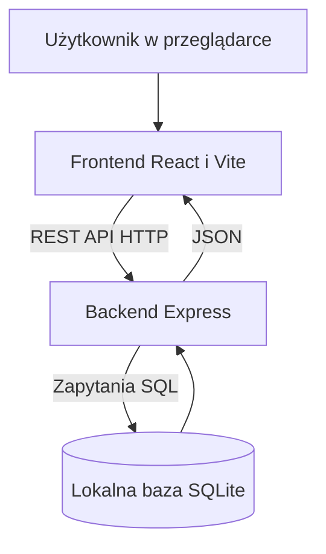

# SalaGo

SalaGo to aplikacja edukacyjna do przeglądania i zarządzania salami uczelnianymi. W aktualnej wersji użytkownik może wyświetlać listę sal, filtrować ją według dostępności i minimalnej pojemności oraz dodawać, edytować i usuwać sale. Aplikacja nie obsługuje jeszcze rezerwacji terminów, logowania ani powiadomień.

## Aktualny stan projektu

- Frontend: React i Vite.
- Backend: Node.js i Express, REST API.
- Baza danych: lokalna SQLite (`backend/salago.db`).
- Integracja: HTTP JSON pomiędzy frontendem a backendem, zapytania SQL do SQLite.
- Środowisko: lokalne. Integracja z Azure SQL Database i automatyczne wdrożenie nie zostały jeszcze wykonane.

## Architektura



## Struktura repozytorium

| Ścieżka | Znaczenie |
|---|---|
| `frontend/` | Interfejs React, formularz i lista sal |
| `frontend/src/services/api.js` | Wywołania REST API |
| `backend/server.js` | Endpointy CRUD i walidacja po stronie serwera |
| `backend/database.js` | Utworzenie bazy i tabeli SQLite, dane początkowe |
| `backend/salago.db` | Lokalny plik danych, ignorowany przez Git |
| `config/`, `docs/` | Katalogi pomocnicze projektu |

## Uruchomienie lokalne

Wymagane są Node.js 22, npm i dwa terminale. Polecenia `npm.cmd` są przeznaczone dla PowerShell w Windows; w innych powłokach można użyć `npm`.

### Backend

Otwórz terminal w folderze `backend` i uruchom:

```powershell
npm.cmd install
node server.js
```

API działa domyślnie na `http://localhost:3000`. Przy pierwszym uruchomieniu `backend/database.js` tworzy `salago.db`, tabelę `sale` i osiem przykładowych rekordów. Kolejne uruchomienia zachowują zapisane dane.

### Frontend

Otwórz drugi terminal w folderze `frontend` i uruchom:

```powershell
npm.cmd install
```

Utwórz lokalny plik `frontend/.env.local`:

```env
VITE_API_BASE_URL=http://localhost:3000/api
VITE_USE_MOCK=false
```

Następnie uruchom:

```powershell
npm.cmd run dev
```

Otwórz adres podany przez Vite, zwykle `http://localhost:5173`. Backend musi być uruchomiony równolegle. Zmienne `VITE_*` są widoczne po stronie przeglądarki, więc nie należy w nich umieszczać haseł.

### Budowanie frontendu

```powershell
cd frontend
npm.cmd run build
```

Wynikiem jest folder `frontend/dist/`.

## REST API

Adres bazowy: `http://localhost:3000/api`.

| Metoda | Endpoint | Opis | Sukces | Typowe błędy |
|---|---|---|---|---|
| GET | `/sale` | Pobranie listy sal | 200 | — |
| GET | `/sale/:id` | Pobranie wskazanej sali | 200 | 404 |
| POST | `/sale` | Utworzenie sali | 201 | 400 |
| PUT | `/sale/:id` | Pełna aktualizacja sali | 200 | 400, 404 |
| DELETE | `/sale/:id` | Usunięcie sali | 204 (bez treści) | 404 |

Przykładowe żądanie `POST /api/sale`:

```json
{
  "nazwa": "D101",
  "budynek": "D",
  "pietro": 1,
  "pojemnosc": 35,
  "wyposazenie": ["rzutnik", "tablica"],
  "dostepna": true
}
```

Przykładowa odpowiedź `201 Created` (identyfikator zależy od stanu bazy):

```json
{
  "id": 9,
  "nazwa": "D101",
  "budynek": "D",
  "pietro": 1,
  "pojemnosc": 35,
  "wyposazenie": ["rzutnik", "tablica"],
  "dostepna": true
}
```

Przykładowa odpowiedź błędu walidacji `400 Bad Request`:

```json
{ "error": "Niepoprawna pojemność" }
```

## Baza danych i walidacja

Tabela `sale` ma kolumny: `id` (klucz główny), `nazwa`, `budynek`, `pietro`, `pojemnosc`, `wyposazenie` i `dostepna`. Lista wyposażenia jest zapisywana jako JSON w kolumnie tekstowej, a dostępność jako wartość 0 lub 1. Backend konwertuje te dane do tablicy i wartości logicznej w odpowiedziach API.

Frontend sprawdza wymagane pola oraz poprawność piętra i pojemności. Backend niezależnie weryfikuje przesłane dane i zwraca status 400 dla niepoprawnych żądań. Interfejs wyświetla stan ładowania, komunikaty powodzenia oraz błędy połączenia lub zapisu.

## Sprawdzenie działania

1. Uruchom backend i frontend.
2. Sprawdź listę sal w interfejsie i pod adresem `http://localhost:3000/api/sale`.
3. Dodaj nową salę, zmień jej dane i sprawdź komunikaty sukcesu.
4. Spróbuj zapisać salę z pojemnością 0 — formularz powinien zablokować zapis.
5. Dodaj salę i uruchom ponownie backend — rekord powinien pozostać w SQLite.
6. Usuń testową salę i sprawdź odświeżoną listę.
7. Zatrzymaj backend i odśwież frontend — powinien pojawić się komunikat błędu połączenia.
8. Uruchom `npm.cmd run build` w folderze frontend.

## Ograniczenia i dalsze prace

- SQLite jest bazą lokalną i nie dowodzi integracji z Azure SQL Database wymaganej docelowo w projekcie chmurowym.
- Przed wdrożeniem do Azure trzeba przygotować bazę Azure SQL, połączenie backendu z nią oraz konfigurację sieci i sekretów.
- Obecna wersja nie realizuje rezerwacji sal, powiadomień ani logowania Microsoft 365.
- Build frontendu został przetestowany lokalnie; automatyczny pipeline CI/CD i wdrożenie chmurowe wymagają osobnej konfiguracji.

## Praca zespołowa

| Osoba | Rola |
|---|---|
| Remigiusz Jasicki | PM / DevOps |
| Bartosz Bowszys | Frontend |
| Filip Sontowski | Backend |
| Oliwier Hanc | DBA |

Zmiany należy przygotowywać na osobnych gałęziach, poddawać przeglądowi w Pull Request i dopiero potem scalać do `main`.

Projekt realizowany w ramach zajęć na WSB Merito Wrocław.
